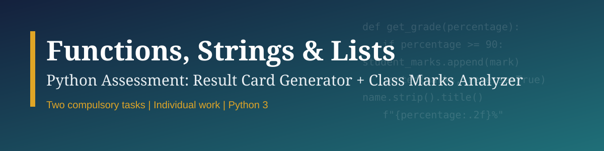
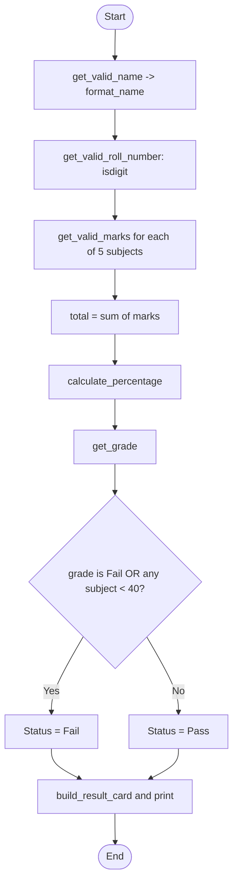
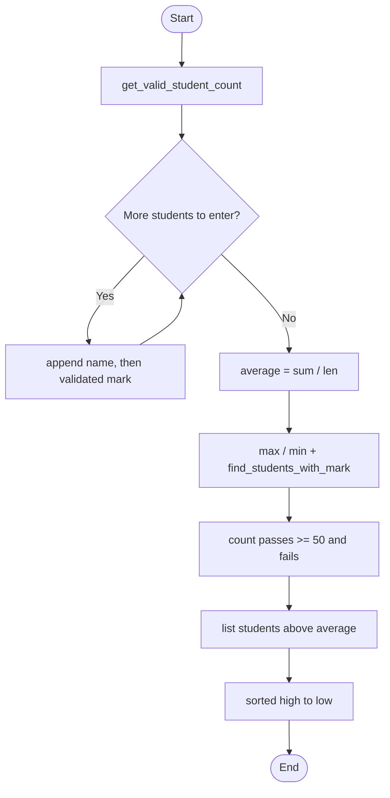
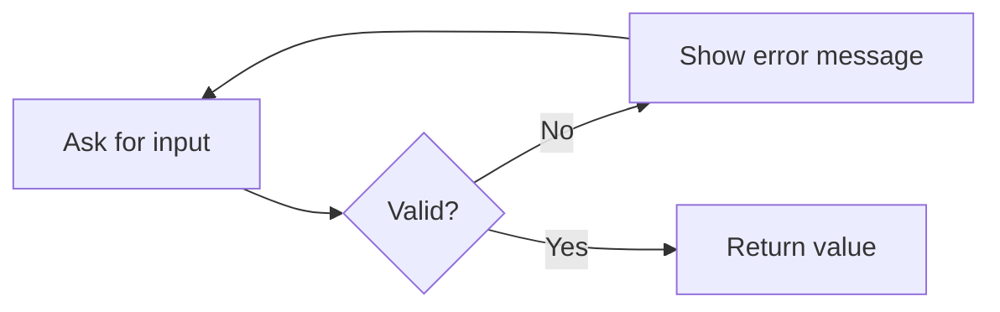
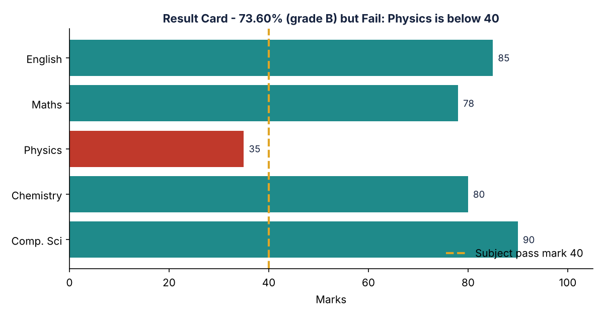
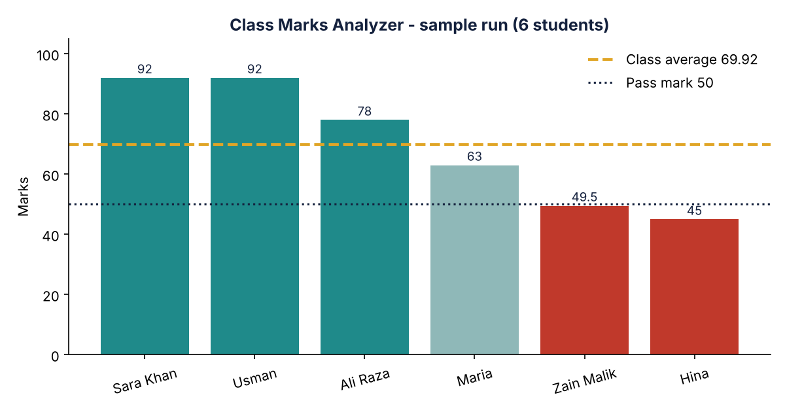

<p align="center"></p>

# Python Functions, Strings & Lists Assessment

[](https://laiba-shehbaz.github.io/python-functions-lists-assessment/preview.html)

## 1. Overview

This repository holds my two compulsory programs for the *Functions, Strings and Lists* assessment (2 days, individual work). Both are console programs written in standard Python 3 with no third-party libraries.

| Task | File | What it does |
|---|---|---|
| 1 | [`result_card_generator.py`](result_card_generator.py) | Validates one student's details and prints a formatted result card with percentage, grade and Pass/Fail status. |
| 2 | [`class_marks_analyzer.py`](class_marks_analyzer.py) | Collects names and marks for a whole class and reports average, highest/lowest, pass/fail counts, above-average students and a ranked list. |

## 2. Repository structure

```text
python-functions-lists-assessment/
├── result_card_generator.py   # Task 1
├── class_marks_analyzer.py    # Task 2
├── README.md                  # this file
├── preview.html               # browser preview of both programs
└── assets/                    # banner and charts used in this README
    ├── banner.svg
    ├── class_marks_chart.png
    └── result_card_chart.png
```

## 3. Program descriptions

### Task 1 - Student Result Card Generator

Asks for a name, roll number and marks in five subjects (English, Mathematics, Physics, Chemistry, Computer Science), each out of 100.

- **Name** is cleaned with `.strip()` and `.title()` and must contain letters only (spaces, `.`, `-`, `'` allowed).
- **Roll number** must pass `.isdigit()`.
- **Marks** must be numbers from 0 to 100; invalid input is re-asked.
- **Grading:** 90+ = A+, 80-89 = A, 70-79 = B, 60-69 = C, 50-59 = D, below 50 = Fail.
- **Override rule:** if any subject is below 40 the final status is **Fail**, whatever the percentage.

| Function | Purpose |
|---|---|
| `format_name(name)` | Strips, title-cases and collapses extra spaces in a name. |
| `get_valid_name()` | Re-asks until the name is valid. |
| `get_valid_roll_number()` | Re-asks until the roll number is digits only. |
| `get_valid_marks(subject)` | Re-asks until marks are a number from 0 to 100. |
| `calculate_percentage(total, max_total)` | Returns the percentage (guards against division by zero). |
| `get_grade(percentage)` | Maps a percentage to a letter grade. |
| `get_final_status(marks_list, grade)` | Applies the "any subject below 40 means Fail" rule. |
| `build_result_card(...)` | Builds the card text with f-strings. |
| `main()` | Runs the program. |

### Task 2 - Class Marks Analyzer

Asks for the class size, then each student's name and marks, stored in two parallel lists (`student_names`, `student_marks`) filled with `.append()`. It then shows the class average, highest and lowest marks with **every** student who achieved them (ties included), passing (50+) and failing counts, students strictly above the average, and marks sorted highest to lowest.

Custom functions (more than the two required): `get_valid_student_count()`, `get_valid_mark(prompt)`, `get_valid_student_name(position)`, `find_students_with_mark(names, marks, target)`, `print_section(title)`, `main()`.

## 4. Methodology

1. **Break the problem into functions** so each one does a single job (validate, calculate, decide, display).
2. **Validate at the point of input** with `while True` loops that only return a valid value.
3. **Keep data and presentation separate:** calculations return values; printing happens in `main()` or the card builder.
4. **Test with normal, boundary and invalid inputs** (see section 7). Every output in this README was produced by actually running the programs.

### Task 1 flow



### Task 2 flow



### Input validation loop (both programs)



### Grading scale

| Percentage | Grade | Status rule |
|---|---|---|
| 90 and above | A+ | Pass unless a subject is below 40 |
| 80-89 | A | Pass unless a subject is below 40 |
| 70-79 | B | Pass unless a subject is below 40 |
| 60-69 | C | Pass unless a subject is below 40 |
| 50-59 | D | Pass unless a subject is below 40 |
| Below 50 | Fail | Fail |

## 5. Python concepts and functions used

| Concept | Where used |
|---|---|
| `def`, parameters, `return` | all helper functions in both files |
| `input()`, `print()` | user interaction |
| `str.strip()`, `str.title()`, `str.split()`, `str.join()` | `format_name`, name handling |
| `str.isdigit()`, `str.isalpha()`, `str.replace()` | roll number and name validation |
| f-strings with format specs (`:<20`, `:>8g`, `:.2f`, `:^46`) | result card and reports |
| `try` / `except ValueError`, `float()` | marks validation |
| `while True` loops, `for` loops, `range()`, `enumerate()`, `zip()` | input loops, reports |
| `if` / `elif` / `else`, chained comparison `0 <= x <= 100` | grading, validation |
| `list`, `.append()`, `len()`, `sum()`, `max()`, `min()`, `sorted()` | Task 2 analysis |
| `lambda` as `sorted` key | ranking with name tie-break |
| `if __name__ == "__main__":` | safe script entry point |

## 6. How to run

Requires Python 3.8 or newer.

```bash
git clone https://github.com/laiba-shehbaz/python-functions-lists-assessment.git
cd python-functions-lists-assessment

python result_card_generator.py    # Task 1
python class_marks_analyzer.py     # Task 2
```

Use `python3` instead of `python` on macOS/Linux if needed. For the browser version, double-click `preview.html`.

## 7. Sample input and output

All transcripts below are real runs (typed answers appear right after each prompt).

### Task 1 - mixed invalid input, then a valid card

Shows name cleaning (`"  ayesha  khan "`), a rejected roll number (`abc`), a non-numeric mark and an out-of-range mark.

```text
=== Student Result Card Generator ===

Enter student name:   ayesha  khan 
Enter roll number (digits only): abc
  Invalid roll number. Digits only, e.g. 1024.
Enter roll number (digits only): 1024
Enter marks in English (0-100): 95
Enter marks in Mathematics (0-100): 88
Enter marks in Physics (0-100): abc
  Invalid input. Please enter a number.
Enter marks in Physics (0-100): 105
  Marks must be between 0 and 100.
Enter marks in Physics (0-100): 92
Enter marks in Chemistry (0-100): 90
Enter marks in Computer Science (0-100): 85

==============================================
             STUDENT RESULT CARD              
==============================================
  Name         : Ayesha Khan
  Roll Number  : 1024
----------------------------------------------
  Subject                Marks
----------------------------------------------
  English                   95 / 100
  Mathematics               88 / 100
  Physics                   92 / 100
  Chemistry                 90 / 100
  Computer Science          85 / 100
----------------------------------------------
  Total Marks  : 450 / 500
  Percentage   : 90.00%
  Grade        : A+
  Final Status : Pass
==============================================
```

### Task 1 - Fail because of one subject below 40

```text
=== Student Result Card Generator ===

Enter student name: Bilal ahmed
Enter roll number (digits only): 2031
Enter marks in English (0-100): 85
Enter marks in Mathematics (0-100): 78
Enter marks in Physics (0-100): 35
Enter marks in Chemistry (0-100): 80
Enter marks in Computer Science (0-100): 90

==============================================
             STUDENT RESULT CARD              
==============================================
  Name         : Bilal Ahmed
  Roll Number  : 2031
----------------------------------------------
  Subject                Marks
----------------------------------------------
  English                   85 / 100
  Mathematics               78 / 100
  Physics                   35 / 100  <- below 40
  Chemistry                 80 / 100
  Computer Science          90 / 100
----------------------------------------------
  Total Marks  : 368 / 500
  Percentage   : 73.60%
  Grade        : B
  Final Status : Fail
==============================================
Note: Failed because at least one subject is below 40.
```



### Task 2 - class of six, with invalid marks and a tie

```text
=== Class Marks Analyzer ===

How many students are in the class? 6
Student 1 name: ali raza
  Marks of Ali Raza (0-100): 78
Student 2 name: sara khan
  Marks of Sara Khan (0-100): 92
Student 3 name: hina
  Marks of Hina (0-100): xyz
  Invalid input. Please enter a number.
  Marks of Hina (0-100): 150
  Marks must be between 0 and 100.
  Marks of Hina (0-100): 45
Student 4 name: usman
  Marks of Usman (0-100): 92
Student 5 name: zain malik
  Marks of Zain Malik (0-100): 49.5
Student 6 name: maria
  Marks of Maria (0-100): 63

--- Class Summary ---
Total students : 6
Class average  : 69.92
Highest marks  : 92 -> Sara Khan, Usman
Lowest marks   : 45 -> Hina

--- Pass / Fail ---
Passing (>= 50) : 4
Failing (<  50) : 2

--- Above Class Average ---
  Ali Raza                78
  Sara Khan               92
  Usman                   92

--- Marks (Highest to Lowest) ---
   1. Sara Khan               92
   2. Usman                   92
   3. Ali Raza                78
   4. Maria                   63
   5. Zain Malik            49.5
   6. Hina                    45

Sorted marks only: ['92', '92', '78', '63', '49.5', '45']
```



Red bars are failing, dark teal bars are above the class average.

## 8. Results and test summary

| # | Program | Scenario | Result observed |
|---|---|---|---|
| 1 | Task 1 | Roll `abc`, marks `abc` and `105` entered first | Each rejected with a message; card shown for the valid values: 450/500, 90.00%, A+, Pass |
| 2 | Task 1 | Physics = 35, others high | 73.60%, grade B, final status **Fail** plus note |
| 3 | Task 1 | All five subjects = 40 | 40.00%, Fail, Fail (40 itself is not below 40) |
| 4 | Task 1 | All five subjects = 100 | 500/500, 100.00%, A+, Pass |
| 5 | Task 2 | 6 students, `xyz` and `150` as marks | Both rejected; average 69.92; tie for highest (Sara Khan, Usman); 4 pass, 2 fail |
| 6 | Task 2 | Class size `x`, then `0`, then `2` | First two rejected, then accepted |
| 7 | Task 2 | Two students both with 50 | Both listed as highest and lowest; 2 pass; "No student scored above the class average." |
| 8 | Task 2 | 49.5 marks | Counted as failing (below 50) |

Scenarios were run manually by feeding inputs to the programs; there is no automated test suite in this repository.

## 9. Design notes

- Marks are read as `float`, so decimals like 49.5 work; `{:g}` prints whole numbers without `.0`.
- `float("nan")` fails the `0 <= x <= 100` check, so it is rejected.
- Ties in the ranking are ordered by name (A-Z) so output is stable.
- "Above average" means strictly greater than the average.

## 10. References

1. Python Software Foundation, *Built-in Types: String Methods* - https://docs.python.org/3/library/stdtypes.html#string-methods
2. Python Software Foundation, *Defining Functions* - https://docs.python.org/3/tutorial/controlflow.html#defining-functions
3. Python Software Foundation, *More on Lists* - https://docs.python.org/3/tutorial/datastructures.html#more-on-lists
4. Python Software Foundation, *Sorting HOW TO* - https://docs.python.org/3/howto/sorting.html
5. Python Software Foundation, *Format String Syntax* - https://docs.python.org/3/library/string.html#format-specification-mini-language
6. van Rossum, Warsaw, Coghlan, *PEP 8 - Style Guide for Python Code* - https://peps.python.org/pep-0008/

## 11. Submission checklist

- [x] `result_card_generator.py`, `class_marks_analyzer.py`, `README.md`
- [x] Functions with clear names and one-line comments
- [x] Input validation in both programs
- [ ] Create the GitHub repo `python-functions-lists-assessment`, push with `git add . && git commit -m "Add assessment" && git push`
- [ ] Submit the repo URL (https://github.com/laiba-shehbaz/python-functions-lists-assessment) on the LMS
